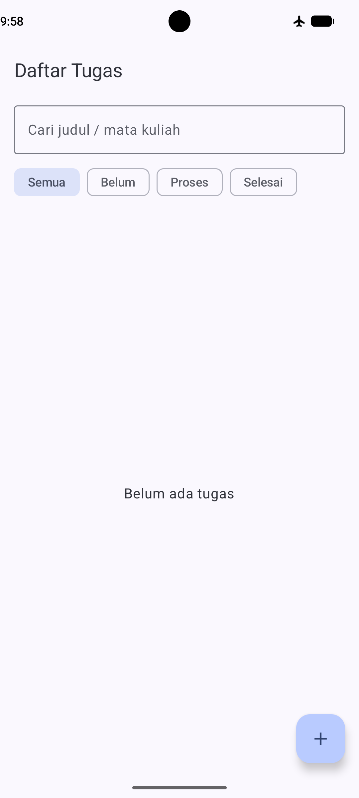
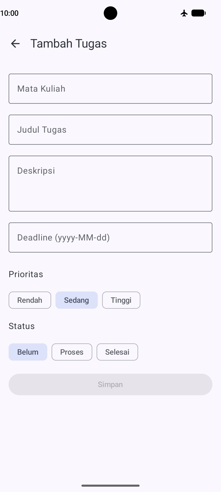
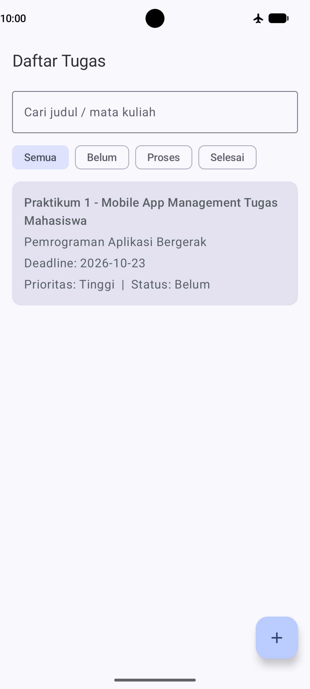
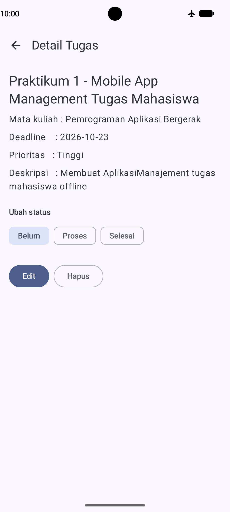
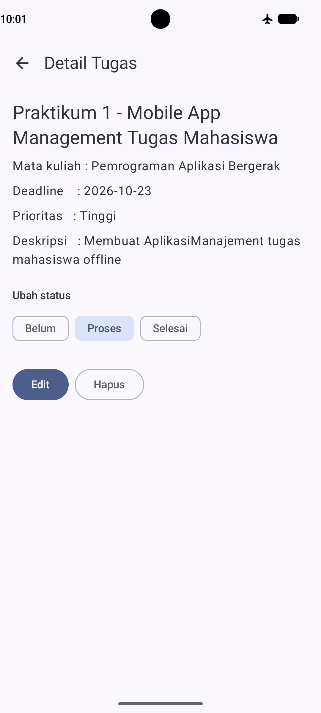
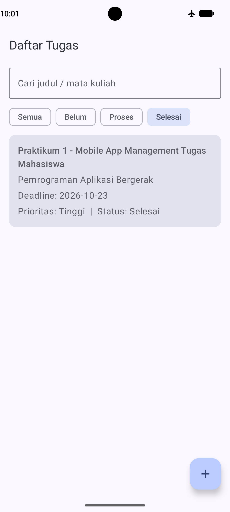

# Aplikasi Manajemen Tugas Mahasiswa (Offline)

Aplikasi Android native (Kotlin, Jetpack Compose) untuk mencatat dan memantau tugas kuliah
tanpa internet. Praktikum 1 Pemrograman Aplikasi Bergerak.

## Fitur
- Daftar tugas dari database lokal
- Tambah, lihat detail, edit, dan hapus tugas
- Ubah status: Belum, Proses, Selesai
- Pencarian dan filter status
- Data tetap tersimpan saat aplikasi ditutup dan saat offline

## Arsitektur
Compose UI → ViewModel → Repository → Room DAO → Database

| Package | Isi |
|---|---|
| `data` | Entity `Tugas`, `TugasDao`, `AppDatabase`, `TugasRepository` |
| `viewmodel` | `TugasViewModel` (UI state & event) |
| `ui` | Layar Compose dan navigasi |

## Cara Menjalankan
1. Clone repository ini
2. Buka di Android Studio, tunggu Gradle Sync selesai
3. Jalankan di emulator atau perangkat fisik

## Screenshot

## Pembuat
Rizky Ilham Febrianto - NIM: 2211002